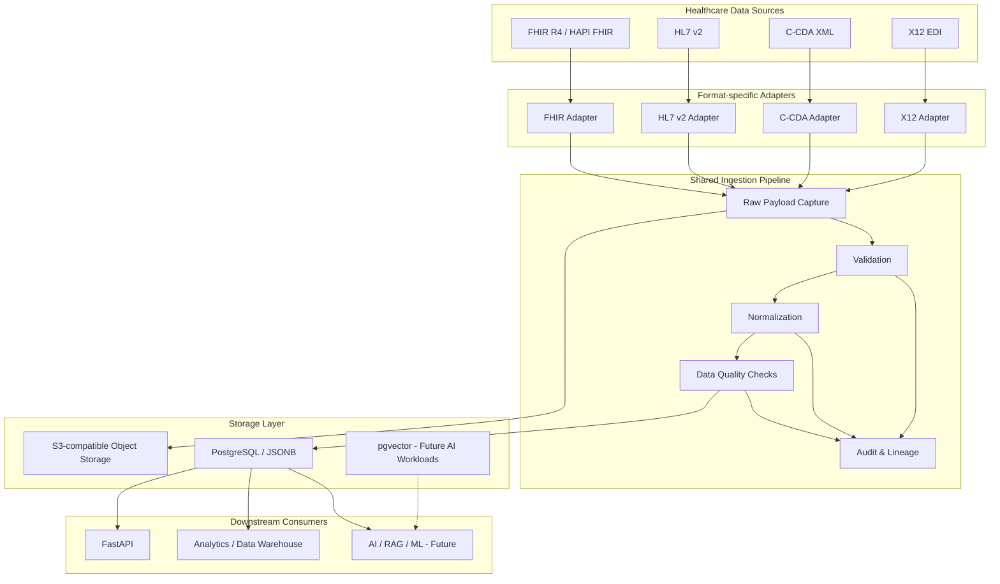

# M2 — Healthcare Data Integration & Interoperability

**Status:** Planned  
**Milestone:** M2  
**Predecessor:** M1 — Local Development Infrastructure  
**Primary standard:** HL7 FHIR R4  
**Development environment:** Linux Mint / WSL2 + Docker Compose  
**Cloud target:** AWS  
**Data policy:** Synthetic or explicitly authorized healthcare data only

---

## 1. Objective

Build a modular healthcare data integration platform that can ingest, validate, store, normalize, and expose healthcare data from multiple interoperability standards.

The platform will initially support FHIR R4 through the existing HAPI FHIR server. Subsequent iterations will add HL7 v2, C-CDA, and X12 integration.

The design must support independent format adapters while sharing common ingestion, validation, storage, observability, and error-handling capabilities.

### Business and engineering objectives

- Demonstrate practical healthcare interoperability engineering.
- Build reusable ingestion adapters for healthcare data formats.
- Preserve original source payloads for traceability and reprocessing.
- Validate incoming data before making it available downstream.
- Maintain data lineage and ingestion audit records.
- Establish a foundation for healthcare analytics, AI/ML, and RAG workloads.
- Keep local development reproducible and prepare for a future AWS deployment.

---

## 2. Scope

### 2.1 In scope

| Capability | Description | Priority |
|---|---|---|
| FHIR R4 integration | Connect to HAPI FHIR and exchange FHIR resources | P0 |
| FHIR resource support | Patient, Practitioner, Encounter, Observation | P0 |
| Raw data storage | Preserve original FHIR JSON payloads in S3-compatible storage | P0 |
| Metadata storage | Store resource metadata and normalized payloads in PostgreSQL | P0 |
| Data validation | Validate resource structure, required fields, and references where applicable | P0 |
| Ingestion tracking | Track source, status, timestamps, and processing errors | P0 |
| Idempotency | Prevent duplicate ingestion of unchanged resource versions | P0 |
| HL7 v2 adapter | ADT, ORM, and ORU message ingestion | P1 |
| C-CDA adapter | Clinical document XML ingestion | P1 |
| X12 adapter | 270/271 eligibility and 837 claims ingestion | P1 |
| Unified pipeline | Shared processing stages across adapters | P1 |
| Data quality framework | Reusable validation and profiling rules | P1 |

### 2.2 Out of scope

The following are explicitly excluded from M2:

- Real patient or production PHI data.
- Clinical decision support or treatment recommendations.
- Production EHR integration.
- Production HIPAA compliance certification.
- Full terminology services and terminology mapping.
- Enterprise identity management and patient matching.
- Production AWS deployment.
- Advanced ML models and RAG implementation.

These may be considered in later milestones.

---

## 3. Target architecture

### 3.1 Logical architecture



### 3.2 Processing flow

All adapters must follow a common processing contract:

1. **Extract** — Receive or retrieve source data.
2. **Capture** — Preserve the original payload and source metadata.
3. **Validate** — Validate format, structure, and required attributes.
4. **Normalize** — Map source data into the platform's canonical representation.
5. **Quality check** — Apply data quality and consistency rules.
6. **Persist** — Store raw data and structured records.
7. **Audit** — Record processing status, timestamps, source, and errors.
8. **Expose** — Make successfully processed data available to authorized consumers.

A failed record must be traceable and must not silently disappear.

### 3.3 Storage responsibilities

**Object storage (PGSTY Silo)**

- Store immutable raw payloads.
- Preserve original JSON, XML, and EDI files.
- Use deterministic object keys where practical.
- Store content hash and source metadata.
- Support future replay and reprocessing.

**PostgreSQL**

- Store ingestion metadata and processing status.
- Store normalized resource representations.
- Use JSONB for flexible healthcare resource payloads.
- Maintain source identifiers and version metadata.
- Support audit and lineage queries.

**pgvector**

- Remains available for future semantic retrieval and AI workloads.
- Is not required for M2 ingestion functionality.

---

## 4. Repository organization

The implementation should follow the existing repository conventions. The structure below is a target, not permission to reorganize unrelated working code.

```text
healthcare-ai-data-platform/
├── src/
│   └── healthcare_platform/
│       ├── api/
│       ├── config.py
│       ├── integrations/
│       │   ├── fhir/
│       │   ├── hl7v2/
│       │   ├── ccda/
│       │   └── x12/
│       ├── ingestion/
│       │   ├── contracts.py
│       │   ├── pipeline.py
│       │   ├── validation.py
│       │   └── audit.py
│       ├── storage/
│       │   ├── object_store.py
│       │   └── repositories/
│       └── models/
├── infrastructure/
│   └── postgres/
│       └── migrations/
├── tests/
│   ├── unit/
│   ├── integration/
│   └── fixtures/
│       ├── fhir/
│       ├── hl7v2/
│       ├── ccda/
│       └── x12/
├── docs/
│   ├── architecture/
│   ├── adr/
│   └── milestones/
│       └── M2-healthcare-data-integration.md
└── ...
```

---

## 5. Task breakdown

### M2.0 — Integration foundation

- [ ] Review the existing M1 repository and architecture.
- [ ] Document integration contracts and shared pipeline responsibilities.
- [ ] Define configuration for source systems and storage.
- [ ] Define ingestion metadata and audit model.
- [ ] Define object-storage abstraction.
- [ ] Add database migrations using the repository's chosen migration approach.
- [ ] Add synthetic healthcare fixtures and test-data policy.

**Deliverable:** Reusable integration foundation and documented architecture.

### M2.1 — FHIR R4 integration

- [ ] Configure connection to local HAPI FHIR R4.
- [ ] Implement a FHIR client abstraction.
- [ ] Support Patient, Practitioner, Encounter, and Observation.
- [ ] Implement resource read and search.
- [ ] Implement safe create/update operations against the sandbox.
- [ ] Validate FHIR resource type and basic structure.
- [ ] Capture original FHIR JSON payloads in Silo.
- [ ] Persist resource metadata and JSONB representation in PostgreSQL.
- [ ] Implement idempotency using source identifiers, version metadata, and content hash.
- [ ] Record ingestion audit status and errors.
- [ ] Add unit and integration tests.
- [ ] Document local execution and examples.

**Deliverable:** Working FHIR R4 ingestion flow from HAPI FHIR to Silo and PostgreSQL.

### M2.2 — HL7 v2 integration

- [ ] Support ADT, ORM, and ORU message types.
- [ ] Implement message parsing and validation.
- [ ] Preserve original HL7 messages in object storage.
- [ ] Map selected fields to canonical healthcare entities.
- [ ] Record processing status and parsing errors.
- [ ] Add synthetic fixtures and tests.

**Deliverable:** HL7 v2 ingestion adapter integrated with the shared pipeline.

### M2.3 — C-CDA integration

- [ ] Parse C-CDA XML documents.
- [ ] Validate XML structure and supported document sections.
- [ ] Extract selected patient, encounter, diagnosis, and medication information.
- [ ] Preserve original XML documents.
- [ ] Map extracted data into canonical representations.
- [ ] Add synthetic fixtures and tests.

**Deliverable:** C-CDA ingestion adapter.

### M2.4 — X12 integration

- [ ] Support X12 270/271 eligibility transactions.
- [ ] Support selected X12 837 claims structures.
- [ ] Parse and validate transaction envelopes and segments.
- [ ] Preserve original EDI payloads.
- [ ] Map selected fields to canonical representations.
- [ ] Add synthetic fixtures and tests.

**Deliverable:** X12 ingestion adapter.

### M2.5 — Unified ingestion pipeline

- [ ] Integrate all adapters with the shared pipeline.
- [ ] Implement consistent validation and error handling.
- [ ] Implement retry policy for transient failures.
- [ ] Implement ingestion audit and lineage queries.
- [ ] Add data quality metrics.
- [ ] Add operational documentation and architecture updates.
- [ ] Run end-to-end integration tests across supported formats.

**Deliverable:** Unified multi-format healthcare data integration platform.

---

## 6. M2.1 acceptance criteria — FHIR R4

M2.1 is accepted only when all applicable criteria pass.

### Connectivity and interoperability

- [ ] The application connects to the local HAPI FHIR server using configuration, not hard-coded URLs.
- [ ] The server's FHIR capability statement can be retrieved.
- [ ] The implementation explicitly targets FHIR R4.
- [ ] Patient, Practitioner, Encounter, and Observation can be searched and read.
- [ ] Create/update operations are tested using synthetic resources.

### Data handling

- [ ] Original FHIR JSON payloads are stored in Silo.
- [ ] Resource metadata and JSONB payloads are persisted in PostgreSQL.
- [ ] Resource type, resource ID, source, version metadata, and content hash are recorded where available.
- [ ] Re-ingesting unchanged content does not create duplicate records.
- [ ] Resource updates can be distinguished from previous versions.
- [ ] Invalid resources are rejected or quarantined with an explainable error.

### Auditability and reliability

- [ ] Each ingestion attempt has a traceable identifier.
- [ ] Processing status and timestamps are recorded.
- [ ] Failures are logged without exposing credentials or sensitive payloads.
- [ ] Transient failures have a documented retry strategy.
- [ ] The original payload remains available for troubleshooting.

### Quality and documentation

- [ ] Unit tests pass.
- [ ] Integration tests pass against the local HAPI FHIR server.
- [ ] Existing M1 tests continue to pass.
- [ ] Ruff lint and format checks pass.
- [ ] GitHub Actions CI passes.
- [ ] Documentation includes setup, configuration, execution, and example results.

---

## 7. Cross-cutting engineering requirements

### Security and privacy

- Use synthetic healthcare data by default.
- Never commit secrets or credentials.
- Keep credentials in environment variables or a secret manager.
- Do not log full patient payloads by default.
- Validate inputs and avoid unsafe XML/EDI parsing.
- Apply least-privilege principles.
- Require human approval for destructive operations and infrastructure changes.

### Observability

Every ingestion attempt should provide:

- Ingestion ID.
- Source system.
- Format and resource/message type.
- Processing status.
- Started and completed timestamps.
- Error category and safe diagnostic message.
- Correlation identifier where applicable.

### Engineering quality

- Use type hints and clear module boundaries.
- Keep source adapters independent of storage implementations.
- Use dependency injection for external clients where practical.
- Keep business logic testable without Docker.
- Use integration tests for actual service communication.
- Avoid introducing unnecessary frameworks or abstractions.

### Compatibility

- Preserve existing M1 functionality.
- Do not change existing service ports or credentials without documenting the reason.
- Avoid destructive database changes.
- Pin dependencies and container versions where practical.
- Do not introduce AWS resources during local M2 development without explicit approval.

---

## 8. Definition of Done for M2

M2 is complete when:

1. FHIR R4, HL7 v2, C-CDA, and X12 adapters are implemented for the agreed scope.
2. All adapters use the shared ingestion contract.
3. Raw payloads are preserved in object storage.
4. Structured data and ingestion metadata are persisted in PostgreSQL.
5. Validation, idempotency, auditability, and error handling are demonstrated.
6. Unit and integration tests pass.
7. CI passes.
8. Architecture and operational documentation are up to date.
9. A reproducible end-to-end demonstration uses synthetic data.

**Important:** Passing this milestone demonstrates an engineering prototype. It does not establish production readiness, regulatory compliance, or clinical safety.

